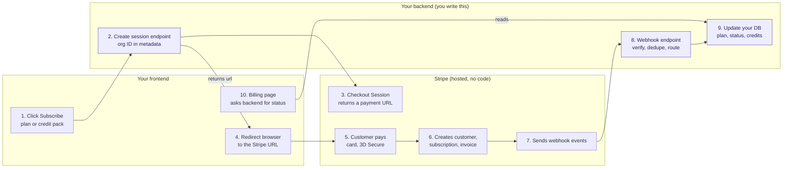
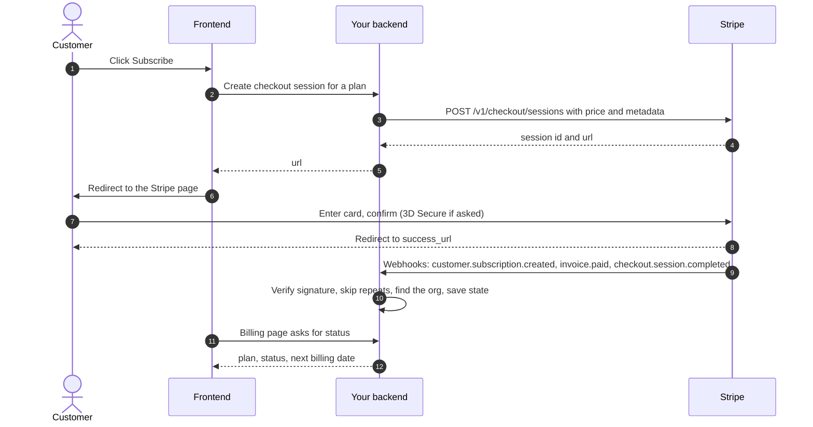
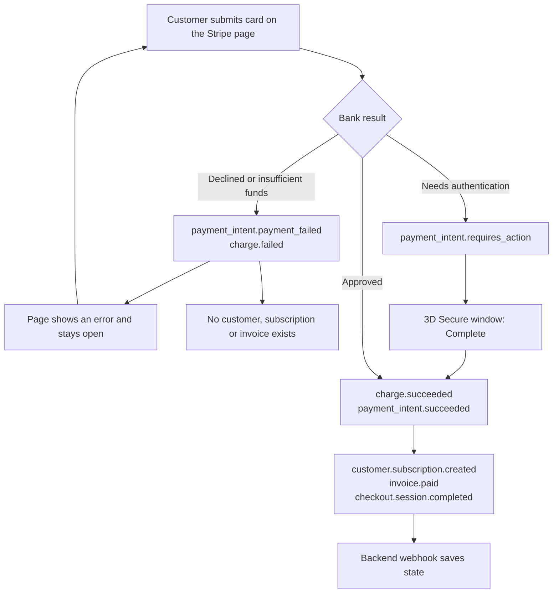
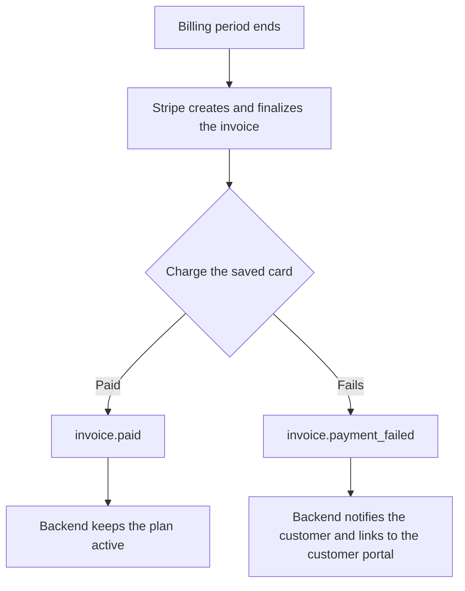
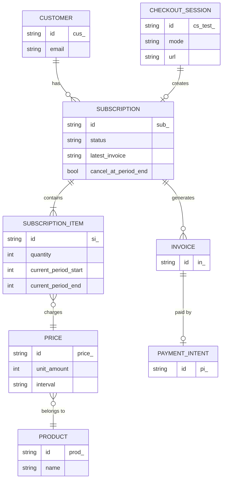

# Architecture

High-level map of how Stripe fits into a SaaS app. This is a **working model**: Stripe-hosted Checkout, Stripe as the billing engine, and your database as a cache of Stripe's state.

## 1. Who does what

Purple boxes are the backend code you write. Everything else is frontend work or hosted by Stripe.

Backend work, in short:

| Step | What you build |
|---|---|
| 2 | An endpoint that finds the user or org, picks the price ID, sets `metadata`, calls Stripe and returns the session `url` |
| 8 | A public webhook endpoint: verify the signature, skip repeated `evt_` IDs, find the org from metadata |
| 9 | Tables for Stripe customer and subscription IDs, plan and status, credit balance, billing history |
| also | A query for the billing page and plan checks for features |

## 2. A successful subscription, over time

Verified on Day 1 (see [events-first-checkout.log](../samples/day-01/events-first-checkout.log)).

## 3. What happens when the first payment fails

Verified on Day 1 (see [events-failed-payments-and-3ds.log](../samples/day-01/events-failed-payments-and-3ds.log)). A failed first payment leaves no customer, subscription or invoice, so your database has nothing to clean up.

## 4. Renewals (expected, not yet verified)

`invoice.payment_failed` belongs to renewals, not to the first payment. To be confirmed with test clocks on Day 2.

## 5. Stripe object model

The objects your code will touch and how they link. Fields come from the Day 1 samples.

## 6. Flows that reuse the same pieces

| Flow | How it fits |
|---|---|
| Monthly renewal | Stripe charges by itself. The same webhook endpoint receives `invoice.paid` or `invoice.payment_failed`. |
| Customer portal | One more small endpoint that asks Stripe for a portal link. |
| Credit packs | Same create-session flow in `mode=payment`. The webhook adds credits to your own balance table. |
| Auto top-up | A job charges a saved card when the balance drops below a threshold. Needs idempotency so two low-balance events cannot buy two packs. |
| Upgrade with more seats | Change the subscription's price and quantity with proration. Needs an invoice preview for "total due now". |
